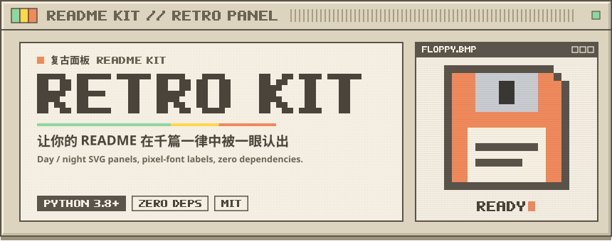
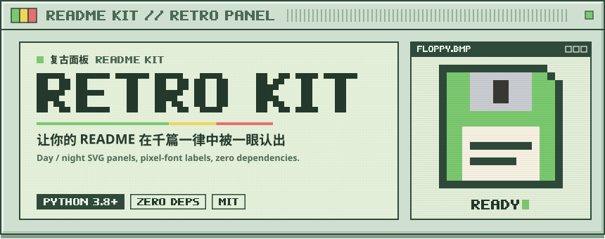
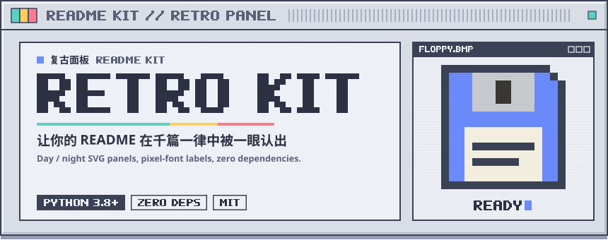

# Retro README Kit

<p align="center">
  <picture><source media="(prefers-color-scheme: dark)" srcset="example/assets/readme/hero-night.svg"></picture>
</p>

> 来源与致谢：视觉语言参考 [MaiBot](https://github.com/Mai-with-u/MaiBot) 的 README（千禧年米色机箱风）。这里把它拆成可复用的设计规则，用一个零依赖生成器重写。像素字体、主题配色、精灵图和布局算法都是原创实现。

一份 JSON 配置生成整套 README 视觉资产：封面、章节标题、按键链接、语言切换、配色一致的 shields 徽章，每件都有日、夜两套 SVG，用 `<picture>` 跟随 GitHub 主题自动切换。完整示例见 [example/README.md](example/README.md)。

## 1. 为什么它能在千篇一律的 README 里抓住眼球

拆解 MaiBot README 后，可以归纳出 6 条可复用的规则：

| # | 规则 | 普通 README | 这套做法 |
|---|---|---|---|
| 1 | **整页只用一个视觉隐喻** | emoji 标题 + 默认 `##` | 整页是一台米色电脑：机箱斜面、散热格栅、指示灯、键帽 |
| 2 | **章节标题做成图片** | `## 安装` 一行字 | 860px 宽的面板条：深色铭牌放英文、浅色放中文，配格栅、编号和指示灯 |
| 3 | **英文用像素字体，并转成 path** | 依赖系统字体，各平台渲染不一 | 文字直接画成 `<path>`，在 GitHub、手机、离线环境看起来都一样 |
| 4 | **日夜两套资产** | 浅色图在暗色模式下发白刺眼 | 每个 SVG 出 `-day` / `-night` 两份，`<picture>` + `prefers-color-scheme` 切换 |
| 5 | **链接做成可按的键帽** | 蓝色超链接或一排 shields | 硬投影、高光描边、主按钮用强调色，看上去可以点 |
| 6 | **色板贯穿到第三方徽章** | shields 默认蓝绿灰 | 徽章 `labelColor` 用机箱描边色，`color` 用三色指示灯，和页面视觉一致 |

另有两处细节：英文用 `<sub><sup>` 小字附在中文下方，双语但不抢主次；封面上的 `READY` 光标用 SVG `<animate>` 闪烁，`` 中的 SVG 在 GitHub 上也能动。

## 2. 工程亮点

- **零依赖**：仅用 Python 3.8+ 标准库，生成一整套资产约 4 ms。
- **自带像素字体**：7 行高、竖笔 2 格宽的原创点阵字体，覆盖 A-Z、0-9 和常用标点。同一行内连续点亮的格子合并为一个矩形子路径，输出体积小，并加 `crispEdges` 保持锐利。
- **日夜结构一致**：两套资产只有颜色不同，几何完全一致。测试会把颜色抹掉后逐字节比对。
- **自适应布局**：章节铭牌宽度、格栅长度、键帽宽度都按文字宽度计算。封面标题自动选最大字号，超长时报错，提示改短，不会悄悄溢出。
- **精灵图**：封面右窗可放字符画精灵图（颜色可写 `$accent`、`$line`、`$led0` 等主题变量），也可以嵌入 PNG/JPG 插画（base64 内联，GitHub 的 `` 中不能引用外部资源）。
- **无障碍**：每个 SVG 都带 `role="img"`、`aria-label` 和 `<title>`，Markdown 里的 `alt` 同步生成。

## 3. 使用

```bash
# 1) 复制 example/readme-kit.json 和 example/README.template.md 到你的仓库并修改
# 2) 生成 SVG 资产，同时根据模板生成 README
python3 readme_kit.py readme-kit.json --template README.template.md --readme README.md
# 3) 可选：生成日夜对照预览页，在浏览器检查
python3 readme_kit.py readme-kit.json --preview preview.html
```

模板中的占位符：

| 占位符 | 输出 |
|---|---|
| `{{kit:hero}}` | 封面 `<picture>` |
| `{{kit:lang}}` | 语言切换键帽组 |
| `{{kit:keys}}` | 主操作键帽组 |
| `{{kit:badges}}` | 配色一致的 shields 徽章行 |
| `{{kit:section:<id>}}` | 第 N 个章节标题 |

未知占位符会直接报错，避免把 `{{kit:...}}` 原样发布出去。

### 配置字段

| 字段 | 说明 |
|---|---|
| `name` / `repo` | 项目名；`repo`（`owner/name`）供 GitHub 动态徽章使用 |
| `theme` | `beige`（默认，米色机箱）、`mint`（掌机绿）、`slate`（工作站蓝） |
| `asset_dir` | SVG 输出目录，相对于配置文件；也是 README 中引用的相对路径 |
| `animate` | `false` 关闭光标闪烁 |
| `hero.kicker` | 标题栏像素字，如 `MYAPP // DIGITAL LIFEFORM` |
| `hero.name_zh` / `name_tag` | 大标题上方的中文名和像素小字 |
| `hero.title` | 像素大标题，建议不超过 12 个字符 |
| `hero.tagline` / `subline` | 中文主标语 / 英文副标语 |
| `hero.chips` | 最多 4 个像素标签，第一个为实心 |
| `hero.window_title` / `status` | 右窗标题、底部状态字 |
| `hero.sprite` | `{palette, rows}` 字符画；与 `hero.image` 二选一 |
| `hero.image` | 插画路径，嵌入右窗（裁切填满） |
| `languages[]` | `{id, label, href, active}` |
| `keys[]` | `{id, label, tag, href, accent}`，`tag` 为右侧像素小字 |
| `badges[]` | 静态：`{label, message}`；动态：`{github: stars|forks|license|contributors|last-commit|release}` |
| `sections[]` | `{id, en, zh}`，按顺序自动编号 01、02… |

## 4. 主题

| beige | mint | slate |
|---|---|---|
| <picture><source media="(prefers-color-scheme: dark)" srcset="example/assets/themes/hero-beige-night.svg"></picture> | <picture><source media="(prefers-color-scheme: dark)" srcset="example/assets/themes/hero-mint-night.svg"></picture> | <picture><source media="(prefers-color-scheme: dark)" srcset="example/assets/themes/hero-slate-night.svg"></picture> |

新增主题时，在 `THEMES` 中补齐 `day` / `night` 两组共 18 个色值和 3 个指示灯色；测试会检查键是否齐全。

## 5. 写作建议

- 标题和按键用像素字体，正文保持普通 Markdown。整页都是图片会影响搜索和复制。
- 章节控制在 4–8 个，太多面板条会显得杂乱。
- 英文副文本用 `<sub><sup>` 跟在中文之后。
- 改了配置就重新生成并提交 SVG；不要手改 SVG，下次生成会被覆盖。

## 6. 运行验证

```bash
python3 -m unittest -v test_readme_kit
```

测试覆盖：字形矩阵规整、宽度计算、日夜资产成对且几何一致、XML 合法性与转义、布局不越界、标题超长报错、精灵图校验与主题变量、图片嵌入、模板占位符、徽章转义、端到端生成，以及渲染耗时基准。

重新生成示例：

```bash
python3 readme_kit.py example/readme-kit.json --template example/README.template.md --readme example/README.md \
  --preview example/preview.html --gallery example/assets/themes
```
