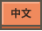
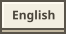
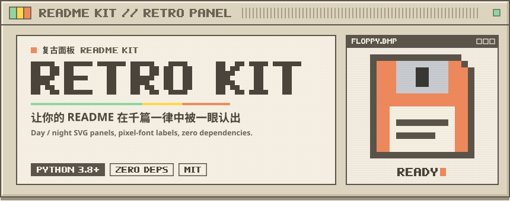
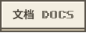
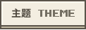

<div align="center">

  <p>
  <a href="#"><picture><source media="(prefers-color-scheme: dark)" srcset="assets/readme/lang-zh-night.svg"></picture></a>
  <a href="#"><picture><source media="(prefers-color-scheme: dark)" srcset="assets/readme/lang-en-night.svg"></picture></a>
  </p>

  <picture><source media="(prefers-color-scheme: dark)" srcset="assets/readme/hero-night.svg"></picture>

  <p>
  
  
  
  
  </p>

  <p>
  <a href="#快速开始"><picture><source media="(prefers-color-scheme: dark)" srcset="assets/readme/key-get-night.svg"></picture></a>
  <a href="../README.md"><picture><source media="(prefers-color-scheme: dark)" srcset="assets/readme/key-docs-night.svg"></picture></a>
  <a href="../README.md#主题"><picture><source media="(prefers-color-scheme: dark)" srcset="assets/readme/key-themes-night.svg"></picture></a>
  </p>

</div>

<picture><source media="(prefers-color-scheme: dark)" srcset="assets/readme/sec-intro-night.svg"></picture>

Retro README Kit 把 README 的每一块视觉（封面、章节标题、按键链接）都做成日夜两套 SVG，用 `<picture>` 跟随 GitHub 主题自动切换。  
<sub><sup>Every visual block of the README is a day/night SVG pair that follows the GitHub theme through <code>&lt;picture&gt;</code>.</sup></sub>

- **像素字体转路径**：英文标签直接画成 `<path>`，任何机器上看起来都一样。  
  <sub><sup><strong>Pixel font as paths</strong>: English labels are drawn as paths and look the same everywhere.</sup></sub>
- **一份配置生成全套**：改 JSON，重新生成，不用手调 SVG。  
  <sub><sup><strong>One config</strong>: edit JSON, regenerate, never hand-tune SVG.</sup></sub>

<picture><source media="(prefers-color-scheme: dark)" srcset="assets/readme/sec-start-night.svg"></picture>

```bash
python3 readme_kit.py readme-kit.json --template README.template.md --readme README.md
```

<picture><source media="(prefers-color-scheme: dark)" srcset="assets/readme/sec-idea-night.svg"></picture>

> **像一件实物，而不是一页文档。**  
> <sub><sup>Make it feel like an object, not a document.</sup></sub>

<picture><source media="(prefers-color-scheme: dark)" srcset="assets/readme/sec-notice-night.svg"></picture>

**License**: MIT
